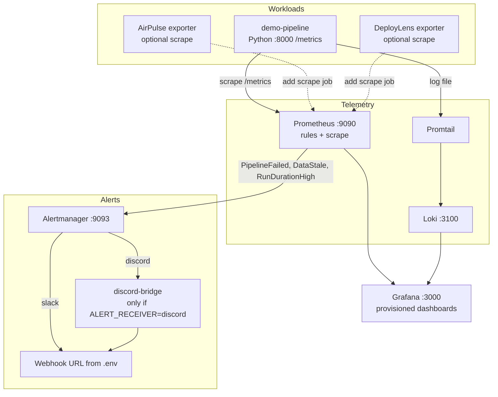

# PipelineWatch

One-command local monitoring for data pipelines and APIs. Prometheus, Grafana, Loki, Promtail, and Alertmanager come up from this repo, with dashboards and alert rules already loaded.


## Quick start

```bash
cp .env.example .env
docker compose up -d --build
```

On PowerShell:

```powershell
Copy-Item .env.example .env
docker compose up -d --build
```

| UI | URL | Login |
|---|---|---|
| Grafana | http://localhost:3000 | `admin` / `admin` |
| Prometheus | http://localhost:9090 | none |
| Alertmanager | http://localhost:9093 | none |
| Demo metrics | http://localhost:8000/metrics | none |

The PipelineWatch folder in Grafana is filled by files under `grafana/provisioning/`. A fresh start does not need any clicks in the UI.

```bash
docker compose down
```

`docker compose down -v` also deletes the metrics, logs, and dashboard database volumes.

## Architecture



The demo pipeline loops about every 15 seconds. Each loop records a duration, and about one run in four fails. A few runs sleep past 30 seconds so the duration alert has something to catch. Metrics are served with `prometheus_client`. The same process appends a log line that Promtail tails into Loki.

Alertmanager does not expand environment variables in its own file. `alertmanager-init` renders `alertmanager/alertmanager.yml.template` from `.env` before Alertmanager starts. An empty `ALERT_WEBHOOK_URL` still boots the stack. Alerts stay visible in the Alertmanager UI.

## Dashboards

### Pipeline health

Up, age of the last success, last duration, duration p95, rows, and failures. http://localhost:3000/d/pipeline-health

### Data freshness

Age against the 24 hour line, budget remaining, and a fresh/stale state. http://localhost:3000/d/data-freshness

### Failure rate

Success ratio against the 95% SLO, and how fast failures are arriving. http://localhost:3000/d/failure-rate

### Logs

Loki panel for `{container="demo-pipeline"}`, plus an error count from the same stream. http://localhost:3000/d/logs

## Alert demo

`PipelineFailed` is the alert that shows up in normal operation. Open http://localhost:9093 after the demo has failed a run. `RunDurationHigh` joins it when a run lands over 30 seconds.

To force the freshness alert without waiting a day, set `DEMO_STALE_HOURS=25` in `.env` and recreate the demo container:

```bash
docker compose up -d --force-recreate demo-pipeline
```

The last-success timestamp stays 25 hours old. `DataStale` has `for: 1m`, so it pages about a minute later. Set `DEMO_STALE_HOURS=0` and recreate the container to go back to a live timestamp.

## SLOs I chose and why

| SLO | Target | Alert |
|---|---|---|
| Freshness | A successful run at least every 24 hours | `DataStale` |
| Success | 95% of runs succeed over a rolling hour | `PipelineFailed` fires on any failure in 5 minutes |
| Duration | 95% of runs finish in under 30 seconds | `RunDurationHigh` |

**Freshness is 24 hours because this stack is for batch pipelines.** A day is the point where downstream jobs are still reading yesterday. The alert and the SLO are the same line. There is no tighter warning stacked on top of the page.

**Success is 95% over the rolling window.** The demo fails about a quarter of its runs, so this SLO burns while you look at it. That is intentional: the failure dashboard should be red on a stock `docker compose up`. 95% is the floor where a person should still look. Below that, a daily batch is dropping enough work to matter. A production pipeline would sit tighter. The number is a starting contract.

**Duration is 30 seconds at the 95th percentile.** The histogram on the health dashboard is the SLO view. The last-run gauge is what `RunDurationHigh` watches, so a single slow run pages without waiting for the quantile to settle. The alert threshold and the SLO line are the same number.

`PipelineFailed` is stricter than the success SLO on purpose. One failure in five minutes is a page. The 95% figure is the budget you read on the dashboard, not a license to ignore the first break.

## Alerts

| Alert | Rule | For |
|---|---|---|
| `PipelineFailed` | `increase(pipeline_failures_total[5m]) > 0` | immediate |
| `DataStale` | last success older than 86400 seconds | 1 minute |
| `RunDurationHigh` | last run longer than 30 seconds | immediate |

### Slack

Set `ALERT_RECEIVER=slack` and `ALERT_WEBHOOK_URL` to a Slack incoming webhook. Then recreate the config and Alertmanager so the rendered file is picked up:

```bash
docker compose up -d --force-recreate alertmanager-init alertmanager
```

### Discord

Discord webhooks expect `{"content": "..."}`, which is not the JSON Alertmanager sends. The `discord` compose profile runs a small bridge that does that translation.

```bash
# .env
ALERT_RECEIVER=discord
ALERT_WEBHOOK_URL=https://discord.com/api/webhooks/...
```

```bash
docker compose --profile discord up -d --build --force-recreate
```

## Plug in AirPulse or DeployLens

`exporter-example/metrics_example.py` is the same metric shape with `pipeline="airpulse"` or `pipeline="deploylens"`. The dashboards and rules already group by that label. Scrape config and the two run commands are in [exporter-example/README.md](exporter-example/README.md).

## Configuration

| Variable | Default | What it does |
|---|---|---|
| `ALERT_RECEIVER` | `slack` | `slack` or `discord` |
| `ALERT_WEBHOOK_URL` | empty | Webhook. Empty keeps alerts in the UI |
| `GRAFANA_ADMIN_USER` | `admin` | Grafana admin |
| `GRAFANA_ADMIN_PASSWORD` | `admin` | Grafana admin |
| `DEMO_FAIL_RATE` | `0.25` | Chance a demo run fails |
| `DEMO_STALE_HOURS` | `0` | Freeze last success this many hours ago |
| `DEMO_INTERVAL_SECONDS` | `15` | Pause between demo runs |

## CI

GitHub Actions, on push and pull request:

1. `docker compose config`, including the Discord profile.
2. `promtool check config`, which also loads the rules.
3. `scripts/check_dashboards.py` parses each dashboard and checks `title`, `uid`, panels, and datasource uids.

## Layout

```text
docker-compose.yml
demo-pipeline/          Python metrics generator
exporter-example/       AirPulse and DeployLens scrape shape
prometheus/             scrape config and alert rules
alertmanager/           template rendered from .env
bridge/                 Discord webhook translator
loki/  promtail/       log pipeline
grafana/provisioning/   datasources and dashboard JSON
```
